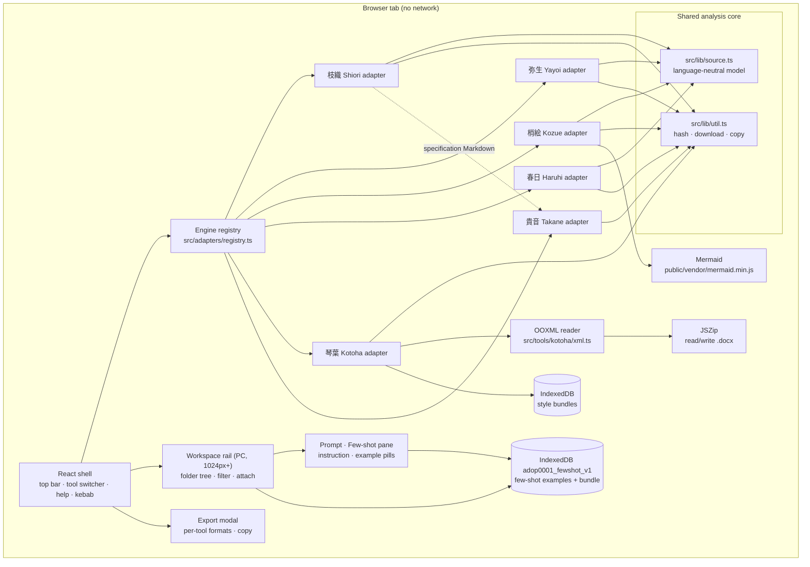
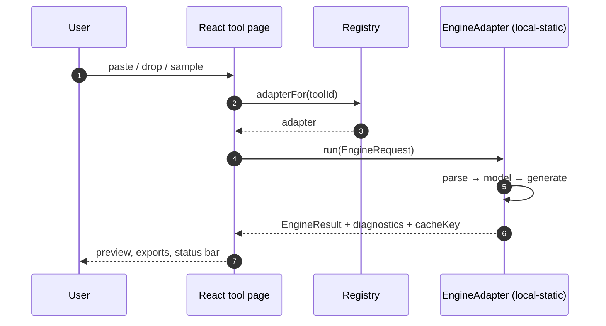
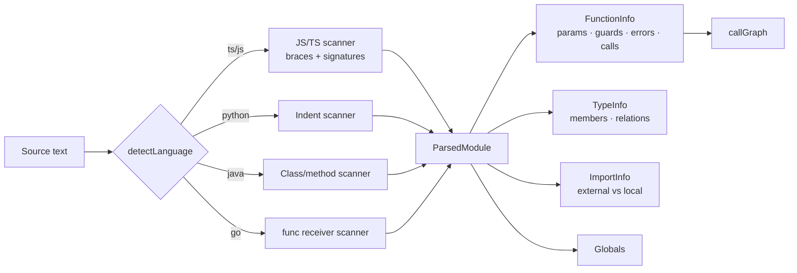
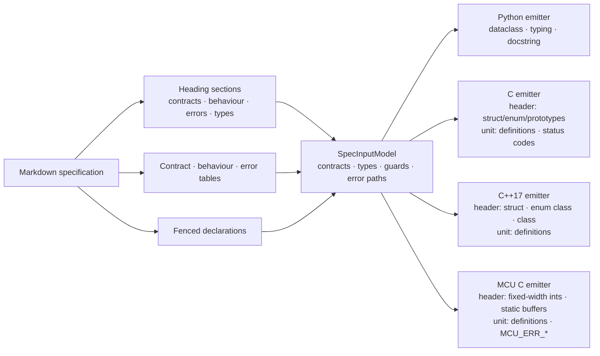
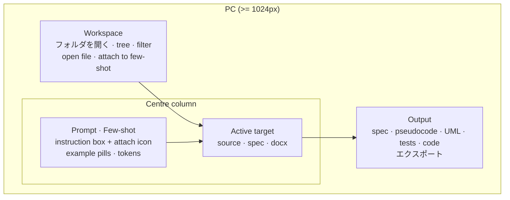
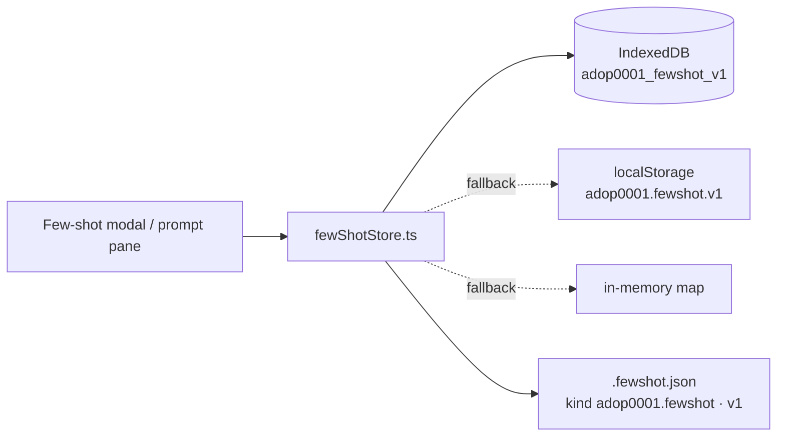
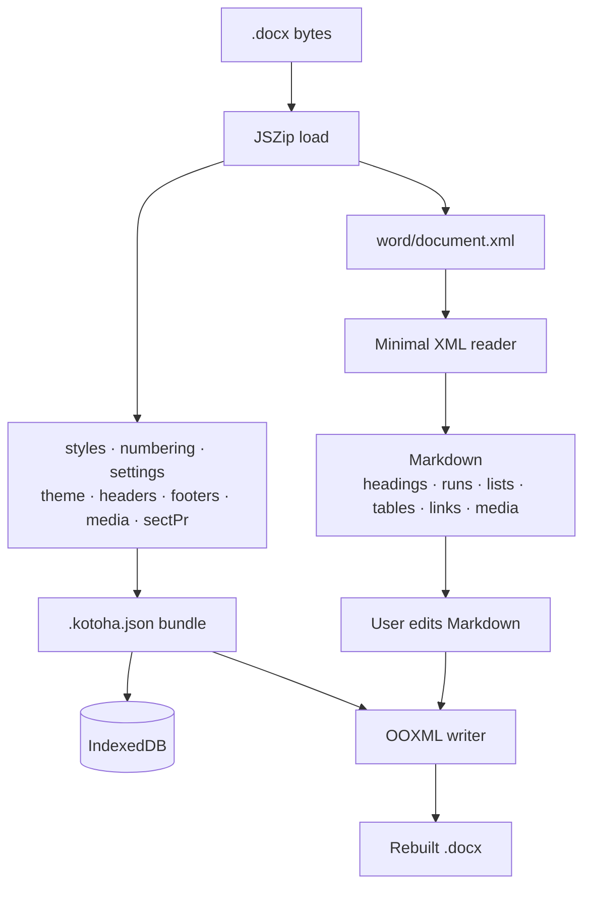
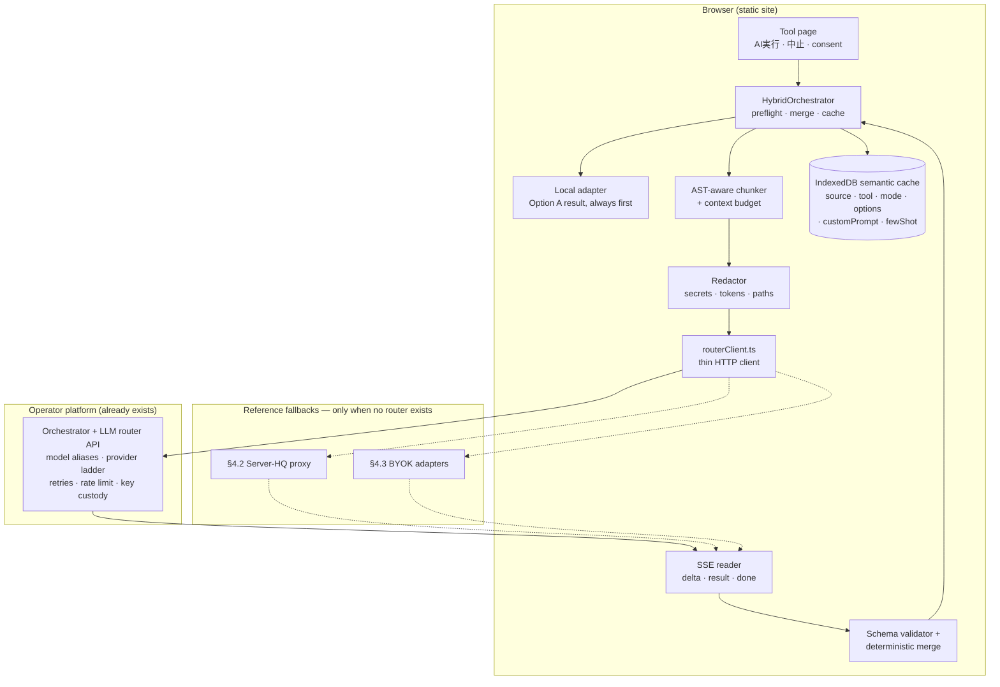
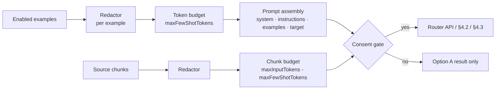

# Architecture — HD2Lab 青松館 (Aomatsukan)

This document describes what ships today (**Option A: pure-browser static/OOXML engines**) and the
exact shape of the planned AI-assisted mode (**Option B: hybrid AI**), including the interfaces, the
thin client contract for the operator's existing orchestrator and LLM router (§4.0), the reference
`Server-HQ` proxy and BYOK contracts, privacy boundaries, merge rules and caching.

The code is the source of truth for the interfaces; the excerpts below are quoted from
`src/adapters/types.ts` and `src/adapters/registry.ts`.

## 0. Language policy

| Surface | Language |
| --- | --- |
| App UI: shell, switcher labels, badges, buttons, tabs, panel titles, status bar, toasts, Help modal, Kotoha inspector, `index.html` meta, `manifest.json`, `og-image.png` | Japanese (Japanese honorific register, developer-tool vocabulary) |
| Repository docs (`README.md`, `ARCHITECTURE.md`) | English |
| Code samples, source identifiers, comments, editor contents | English |
| Tool outputs: 枝織 specification Markdown/HTML and its preview, 弥生 pseudocode and narrative/compact styles, 梢絵 Mermaid `.mmd` and detection explanations, 春日 generated test files, 琴葉 sample `.docx`, decomposed Markdown and rebuilt `.docx`, 貴音 Python/C/C++/MCU scaffolds, the Option B prompt assembly preview | English |
| Workspace rail, prompt/few-shot pane, export modal, few-shot modal | Japanese chrome, English file paths and code |

Proper nouns and format names (`HD2Lab`, `Aomatsukan`, `Markdown`, `HTML`, `UML`, `Mermaid`,
`SVG`, `PNG`, `JSZip`, `OOXML`, `IndexedDB`, `Vitest`, `Jest`, `Pytest`, `JUnit 5`, `Go testing`,
`.docx`, `.kotoha.json`, `HD2Lab Web-HQ`, `ApplicationHub`, code symbols and identifiers) are kept
as they are in both surfaces.

---

## 1. Top-level structure



Every tool is a pure function behind the same port. The UI never branches on provider: it asks the
registry for an adapter and calls `run()`.



---

## 2. Ports: `EngineAdapter` and `HybridOrchestrator`

Quoted from `src/adapters/types.ts`:

```ts
export type ToolId = 'shiori' | 'yayoi' | 'kozue' | 'haruhi' | 'kotoha' | 'takane';
export type ProviderMode = 'local-static' | 'hybrid-ai';
export type PromptStrategy = 'zero-shot' | 'few-shot';

export interface FewShotExample {
  id: string;
  toolId: ToolId;
  title: string;
  role: 'pair' | 'input' | 'output';
  inputFileName?: string;
  inputText?: string;
  outputFileName?: string;
  outputText: string;
  targetLanguage?: string;   // takane: python | c | cpp | mcu
  enabled: boolean;
  estimatedTokens: number;
  updatedAt: string;
}

export interface EngineRequest<TOptions = Record<string, unknown>> {
  toolId: ToolId;
  sourceName: string;       // uploaded file name: language detection + output naming
  source: string;           // raw source text (binary tools carry payload in options)
  options: TOptions;
  mode: ProviderMode;
}

export interface EngineDiagnostic {
  severity: 'info' | 'warn' | 'error';
  message: string;
  line?: number;
}

export interface EngineResult<TOut> {
  output: TOut;
  providerMode: ProviderMode;
  diagnostics: EngineDiagnostic[];
  elapsedMs: number;
  cacheKey: string;         // sha256(toolId + providerMode + source + options)
}

export interface EngineAdapter<TOut, TOptions = Record<string, unknown>> {
  readonly id: ToolId;
  readonly title: string;          // English, e.g. "Specification Writer"
  readonly japaneseTitle: string;  // brand title, e.g. "枝織"
  readonly providerMode: ProviderMode;
  readonly capabilities: readonly string[];
  run(request: EngineRequest<TOptions>): Promise<EngineResult<TOut>>;
}

export interface ContextBudget {
  maxInputTokens: number;
  maxOutputTokens: number;
  chunkOverlapTokens: number;
  maxFewShotTokens: number;  // cap for the example block
}

export interface PreflightReport {
  allowed: boolean;
  reason?: string;
  estimatedInputTokens: number;
  estimatedCostUsd?: number;
  redactions: number;
  fewShotExampleCount: number;
  fewShotTokens: number;
}

export interface HybridRequest<TOut, TOptions = Record<string, unknown>>
  extends EngineRequest<TOptions> {
  consent: boolean;              // explicit opt-in gate, never implied
  budget?: ContextBudget;
  signal?: AbortSignal;
  _out?: TOut;
  promptStrategy?: PromptStrategy;
  fewShotExamples?: FewShotExample[];
}

export interface HybridOrchestrator<TOut, TOptions = Record<string, unknown>> {
  readonly adapter: EngineAdapter<TOut, TOptions>;
  readonly mode: 'hybrid-ai';
  preflight(request: HybridRequest<TOut, TOptions>): Promise<PreflightReport>;
  runHybrid(
    request: HybridRequest<TOut, TOptions>,
    onDelta?: (chunk: string) => void,
  ): Promise<EngineResult<TOut>>;
  merge(local: TOut, remote: TOut): TOut;   // deterministic, local facts win
}
```

The port is deliberately thin. `HybridOrchestrator` owns preflight, redaction, token budgeting, SSE
normalisation, schema validation and the deterministic merge; it does **not** own model selection,
provider adapters, retry ladders, rate limiting or key custody. Those already exist once in the
operator's orchestrator and LLM router, and Option B reaches them through
`src/adapters/routerClient.ts` (§4.0.3). A future `hybrid-ai` adapter wires this port to that client
and changes nothing else in the UI.

### Registry contract

`src/adapters/registry.ts` exports `TOOLS: ToolMeta[]`, one entry per tool:

| Field | Contract |
| --- | --- |
| `id` | Unique `ToolId`; also the hash route segment and the cache-key prefix. |
| `path` | `#/<id>` deep link. |
| `japanese`, `label` | Japanese brand title (e.g. `枝織`) and the Japanese switcher label (e.g. `仕様書作成`) shown in the top bar, the `⋮` menu and the tool head. |
| `tagline`, `longDescription` | Japanese copy for the tool head and the Help modal. |
| `adapter.title` | English engine name (e.g. `Specification Writer`), kept for the adapter port; the UI shows `japanese` / `label`. |
| `adapter` | The live `EngineAdapter`. Swapping the adapter is the only change needed to move a tool from Option A to Option B. |

The UI reads `tool.adapter.capabilities` to explain a tool in Help, and calls `adapter.run()` with
`mode` set to the adapter's own `providerMode`. There is no other coupling.

---

## 3. Option A — pure browser static / OOXML

### 3.1 Shared static analysis (`src/lib/source.ts`)

One language-neutral model feeds 枝織, 弥生, 梢絵 and 春日:



The parser is deliberately heuristic: line-oriented scanning with brace/indent block detection,
string and comment stripping, and top-level comma splitting for parameter lists. It never claims
AST precision, and diagnostics surface that when nothing is found.

### 3.2 Tool pipelines

| Tool | Pipeline | Output type |
| --- | --- | --- |
| 枝織 | model → contracts/rules/deps → Markdown → standalone HTML | `ShioriOutput` |
| 弥生 | model → statements → style renderer → pseudo lines + `toSource`/`fromSource` maps | `YayoiOutput` |
| 梢絵 | model → five scored candidates → Mermaid for each kind → render selected | `KozueOutput` |
| 春日 | model → cases carrying their own inputs (happy/boundary/guard/error) → framework emitter → static branch checklist | `HaruhiOutput` |
| 琴葉 | `.docx` bytes → JSZip → XML reader → Markdown + bundle → rebuild `.docx` | `KotohaOutput` |
| 貴音 | Markdown specification → headings/tables/bullets/fences → `SpecInputModel` → per-language emitter (Python/C/C++/MCU) | `TakaneOutput` |

### 3.2.1 Haruhi test-case IR and the two coverage numbers

春日 derives cases once, in `src/tools/haruhi/ir.ts`, and every emitter in
`src/tools/haruhi/emit.ts` renders that same list. A case owns:

* `inputs` — one neutral literal per parameter (`0`, `''`, `[]`, `{ invoiceId: '' }`, …), so the
  test name, the printed `Given`/`When` and the emitted call cannot disagree. Boundary values are
  applied to one parameter at a time; guard conditions are turned back into inputs
  (`b === 0` → `divide(42, 0)`, `!email` → `''`, `!request.invoiceId` → `{ invoiceId: '' }`,
  `value < low` → `(0, 1)`), and an input that trips a guard is dropped from the passing cases.
* `expectation` — `throws(RangeError)`, `returns` with a contract-level check, or `completes` for a
  void function. Async functions get `await expect(...).rejects` / `resolves`, class methods get a
  `new Subject()` (or are skipped when the constructor needs dependencies), static methods are
  called on the class.
* `status` — `asserted`, `todo` (only the declared return type is checked, the exact value is a
  TODO) or `unsupported` (emitted as a skipped test with the reason, never as a dummy assertion).

| Metric | Meaning | When it is shown |
| --- | --- | --- |
| 静的ブランチ対応率 (`staticMappingRate`) | share of reachable branches a non-skipped case targets, with `mapped` / `unmapped` / `unsupported` per branch and the function, line and case id as evidence | always |
| 実行カバレッジ (`executedCoverage`) | coverage measured by running the generated tests | `N/A` — 春日 never runs them in the browser |

`coverage` remains as a backwards-compatible alias of the static rate; the UI never presents it as
executed coverage.

### 3.3 Takane specification-to-code pipeline



The parser accepts both the Markdown that 枝織 writes (`# Specification — …`, `## 2. Contract table`,
`### `signature``, behaviour rules, error paths, data types) and a hand-written specification made of
headings, tables, bullet lists and fenced code. The generated scaffold carries type declarations,
class/module signatures with parameter defaults and return types, guard clauses derived from the
behaviour rules, error paths, and language-native doc comments. Every TODO marker points
at the contract it belongs to.

Four output targets ship today, and 貴音 defaults to `python`:

| Target | Shape | Notes |
| --- | --- | --- |
| `python` | `@dataclass`, `str, Enum`, typed methods, docstrings | `raise ValueError` on guards, `NotImplementedError` placeholder |
| `c` | two files: `payment_service.h` (guard macro, status enum, `typedef struct`, prototypes) and `payment_service.c` (`#include "payment_service.h"`, definitions) | contracts return a status code; the result travels through an out-parameter |
| `cpp` | two files: `payment_service.hpp` (`#pragma once`, `namespace`, `struct`, `enum class`, class declarations) and `payment_service.cpp` (`Class::method` definitions) | `std::invalid_argument` on guards, `std::runtime_error` placeholder |
| `mcu` | the C emitter in embedded mode, also split into `_mcu.h` (fixed buffers, `_Static_assert` bounds) and `_mcu.c` | `<stdint.h>` fixed-width integers (`uint8_t`, `uint16_t`, `uint32_t`, `int32_t`), `char` buffers with `_TEXT_MAX`, fixed arrays with `_ITEMS_MAX`, `memchr` NUL-termination checks, `MCU_OK = 0` / `MCU_ERR_INVALID_ARG` / `MCU_ERR_UNIMPLEMENTED`, no `malloc` |

Signatures that a target language cannot express are repaired and reported rather than emitted
broken: Python and C++ reorder a defaulted parameter that precedes a required one
(`PY-PARAM-ORDER`, `CPP-PARAM-ORDER`), Python does the same for dataclass fields
(`PY-FIELD-ORDER`), and both diagnostics appear in the output pane. Error messages are escaped
per language (`\"`, `\\`, `\n`), and a return type that only exists in another header keeps its
declaration but skips the definition with a TODO, because a by-value return needs the complete type.
The output pane lists every generated file and the diagnostics; the export modal writes each file
separately or all of them at once.

Guard conditions are translated structurally rather than textually substituted: `!request.invoiceId`
becomes `request->invoice_id == NULL` in C, `request.invoice_id.empty()` in C++, and
`request->invoice_id[0] == '\0'` on the MCU target. A condition the translator cannot express
faithfully (for example `SUPPORTED_CURRENCIES.includes(currency)`) is emitted as a `TODO` comment
instead of invented code. 枝織 stores its latest Markdown in `localStorage`
(`adop0001.shiori.latest`), so 貴音's **Load latest Shiori spec** button closes the
code → specification → code loop without touching the network.

### 3.4 PC studio layout: workspace rail + centre stack + output

At `min-width: 1024px` the app is a three-column studio; below that the same components stack and
the rail and centre-top pane disappear.



| Column | Component | Behaviour |
| --- | --- | --- |
| Left (>= 1024px) | `src/components/WorkspacePanel.tsx` | `フォルダを開く` uses `window.showDirectoryPicker()` when available and falls back to a hidden `<input type="file" webkitdirectory multiple>`; the tree is built by `src/lib/workspace.ts` (`node_modules`, `.git`, `dist`, `build`, `.next` pruned), filtered by file name, and every file has an open action plus an attach-to-few-shot action. Collapsing is remembered in `localStorage` (`adop0001.workspace.open`). |
| Centre top (>= 1024px) | `src/components/PromptPane.tsx` | Per-tool custom instruction (localStorage `adop0001.prompt.<toolId>`), Input/Output `ファイルを開く` pair, enabled example pills with token estimates, and the paperclip icon at the bottom-right of the instruction box (`aria-label` `Few-shot例示ファイルを追加`, numeric badge = active examples) that opens the manager. |
| Centre bottom | the tool's first pane | The active input: code for 枝織/弥生/梢絵/春日, specification Markdown for 貴音, `.docx` or bundle for 琴葉. |
| Right | the tool's second pane | The tool output, with a single `エクスポート` button. |

Layout mechanics: `main.workspace` becomes the CSS grid
`"head head" / "prompt output" / "input output" / "status status"`, and `.panes { display: contents }`
promotes each tool's two `section.pane` elements into grid items, so a tool keeps its own markup while
the shell owns placement. Below 1024px the grid collapses to the previous single-column flow.

Files opened from the rail reach a tool through `src/lib/fileBus.ts`: the rail publishes
`OpenedFile { path, name, text, file }` for the routed tool (`src/lib/fileKinds.ts`
`targetToolForFile`), and a publish made before that tool mounts is queued and delivered on subscribe.

### 3.5 Few-shot example store (Option A half of Option B)

`src/lib/fewShotStore.ts` owns every example locally:



* Entries are normalised on save: role derived from the presence of input text, token estimate
  recomputed (`estimateTokens`: 4 ASCII characters ≈ 1 token, 1 CJK character ≈ 0.625 tokens),
  `updatedAt` stamped.
* `budgetExamples()` truncates deterministically: enabled examples in most-recent order, each one
  either fits whole or is skipped so a single huge file cannot crowd out the rest.
* `assemblePromptPreview()` and `renderPromptText()` build the exact text the Option B request would
  carry (system → operator instructions → examples → target), which is what the `プロンプト合成プレビュー`
  tab shows. Nothing is sent.
* Bundle export/import validates `kind`, `version <= 1`, and per-example output text; imports merge by
  id.

### 3.6 Unified export

One `src/components/ExportModal.tsx` serves all six tools. Each tool passes its formattable artifacts
as `ExportFormat { label, description, fileName(base), run(base), copy? }`; the modal edits the base
file name, previews every final name, downloads with one click and reports copy feedback. The output
pane keeps only the `エクスポート` button, so the action bar stays quiet.

| Tool | Formats |
| --- | --- |
| 枝織 | `.spec.md`, `.spec.html` (+ Markdown copy) |
| 弥生 | `.pseudo.md`, `.pseudo.txt` (+ plain copy) |
| 梢絵 | `.svg`, `.png`, `.mmd` (+ Mermaid copy) |
| 春日 | the active framework's test file (+ copy) |
| 琴葉 | rebuilt `.docx`, `.kotoha.json`, edited `.md` (+ Markdown copy) |
| 貴音 | `.py`, `.c` + `.h`, `.cpp` + `.hpp`, `.c` + `.h` (MCU), or all files of the active language (+ code copy) |

### 3.7 Kotoha OOXML engine



Preserved verbatim in the bundle and written back on rebuild: `styles.xml`, `theme/*`,
`numbering.xml`, `header*.xml`, `footer*.xml`, `settings.xml`, `fontTable.xml`, `media/*`,
`docProps/*`, `[Content_Types].xml`, package and document relationships, and the section
properties (`sectPr`, with edited page size/margins patched in place).

The Style & Attribute Inspector edits a typed view of the bundle (`BundleAttributes`): base font,
body size, line spacing, page margins, heading colours. On rebuild those edits are applied to
`styles.xml` (docDefaults + Normal + Heading1..3) and to `pgSz`/`pgMar`, so a rebuild both keeps the
template and honours the edits.

---

## 4. Option B — planned AI hybrid

> **Implementation rule for the next agent — reuse the operator's orchestrator and LLM router.**
> The operator's platform (`Server-HQ`) already runs an orchestration layer and an LLM router with
> model aliases, a provider ladder, retries, timeouts, token policy and key custody. Option B is
> therefore a **thin client** on top of that API. Do not build a second proxy, a model router, a
> provider-fallback ladder, a rate limiter or a key vault inside `ADOP0001`. Read §4.0 before
> writing any Option B code; §4.2 and §4.3 are reference fallbacks for a deployment that has no
> orchestrator at all.

### 4.0 Agent implementation rule — existing orchestrator & LLM router first

#### 4.0.1 Step 0 — inspect the operator's environment before designing

An implementing agent must establish what already exists before writing any Option B code. For this
operator the answer is recorded below; verify it against the deployed service and against the
operator, because a document can lag the running system.

| What to check | Where it is documented | What it settles |
| --- | --- | --- |
| Model router and policy engine | `Server-HQ/docs/AI_GATEWAY_AND_CHATBOT_ARCHITECTURE.md` — AI Gateway: `gateway.json` model aliases, provider targets (local vLLM/Ollama, NVIDIA NIM/OpenAI/OpenRouter), reasoning effort, timeout guard up to 600 s | model selection, provider fallback, retries, token and time limits |
| HTTP surface of the router | same document: `POST /v1/chat/completions` (`model`, `messages`, `stream`, `reasoning_effort`, `contract_id`), SSE `choices[].delta.content` terminated by `data: [DONE]`, `GET /v1/contract/{contract_id}` for stream recovery | the request and response dialect the client must speak |
| Multi-step orchestration | `Server-HQ/docs/HD2AI_ADMIN_IMPLEMENTATION_SCOPE_20261113.md` — AGCore `POST /admin/agcore/api/v1/agent/runs` | whether one ADOP0001 action is a single completion or one orchestrator run |
| Reachability from the static site | the deployed edge (`/HD2AI/`, `/admin/…`), the operator, and the browser's CORS preflight | whether the site may call the router directly with a session cookie, needs an `Authorization: Bearer` token, or needs a same-origin path |
| No router at all | the result of this step | if nothing exists, §4.2 (proxy) or §4.3 (BYOK) becomes the plan, still behind the same port |

Record the outcome of Step 0 in the pull request that implements Option B (what exists, what was
reused, which base URL and auth kind the client was configured with). A future agent reading that
record does not have to repeat the survey.

#### 4.0.2 What must NOT be implemented inside `ADOP0001`

If Step 0 finds an orchestrator and a router, none of the following belongs in this repository:

- a model catalogue, alias table, capability matrix, or any "pick a provider/model" logic;
- provider SDKs, adapters, retry/backoff ladders, circuit breakers or client-side rate limiters;
- per-family prompt templates that assume a particular vendor's formatting;
- an API-key vault, key rotation, usage metering or cost accounting;
- a second reverse proxy or BFF that re-exposes the router's endpoints;
- queues or background workers for long runs — the router and the orchestrator own those.

Each of these already exists once, under the operator's policy and audit. A second copy inside the
browser bundle costs a token of drift on every router change, doubles the surface where a secret can
leak, and splits the one place where limits are enforced.

#### 4.0.3 What must be implemented — the exact client API surface

**(1) Decoupled execution trigger.** Editing must stay free. The debounced `local-static` pass keeps
producing the Option A preview on every keystroke with no network activity. The AI pass is a
deliberate act: an explicit `AI実行` (hybrid run) button, an `中止` cancel button backed by one
`AbortController`, and a consent gate (§4.1) beside the button. No timer, no "run on idle", no
run on paste — an edit never spends tokens by itself.

**(2) Thin client request envelope.** `RouterRequestPayload` (declared beside `HybridRequest` in
`src/adapters/types.ts`) is built from the active tool state and the few-shot store:

```ts
export interface RouterRequestPayload {
  toolId: ToolId;
  sourceName: string;
  source: string;                      // redacted raw source
  options: Record<string, unknown>;    // language, framework, sections, style
  customPrompt: string;                // prompt pane text for this tool (readPrompt(toolId))
  promptStrategy: PromptStrategy;
  fewShotExamples: FewShotExample[];   // enabled, budgeted and redacted (§4.8)
  schemaVersion: string;               // the tool's output schema (§4.6)
  requestId: string;                   // uuid v4 per click, echoed in the stream and in logs
}
```

The client-side `Redactor` runs before the envelope leaves the browser: `source`,
`customPrompt` and every example are redacted, and a payload that still matches a secret pattern
aborts `preflight()` so nothing is sent (§4.5). When the router's context window requires it, the
chunk list of §4.4 travels as an optional `chunks` sibling; the eight fields above are the required
minimum and the only shape the router contract may rely on.

**(3) `src/adapters/routerClient.ts` — the whole integration.** One module, no service classes:

```ts
export interface RouterClientConfig {
  baseUrl: string;                     // VITE_ORCHESTRATOR_URL | VITE_ADOP_PROXY | runtime setting
  auth: { kind: 'bearer'; token: string } | { kind: 'session' };
  modelAlias?: string;                 // a router alias, never a provider model list
  timeoutMs: number;                   // default 45_000
}

export interface RouterClient<TOut> {
  stream(
    payload: RouterRequestPayload,
    onDelta: (text: string) => void,
    signal: AbortSignal,
  ): Promise<EngineResult<TOut>>;
}
```

The request it sends:

```http
POST {baseUrl}
Authorization: Bearer <session token>      (omitted when auth.kind = 'session')
Content-Type: application/json
Accept: text/event-stream
X-Request-Id: <requestId>

{
  "toolId": "takane",
  "sourceName": "payment-service.md",
  "source": "…",
  "options": { "language": "mcu" },
  "customPrompt": "Keep every contract name verbatim.",
  "promptStrategy": "few-shot",
  "fewShotExamples": [ { "id": "ex1", "title": "gpio emitter", "role": "pair", "output": "…MCU C…" } ],
  "schemaVersion": "1.0",
  "requestId": "0f9c2b6a-…"
}
```

Response dialects the client accepts — the parser normalises all three into one `onDelta` callback
and one `EngineResult`:

| Dialect | Frames | Handling |
| --- | --- | --- |
| ADOP stream (this document) | `event: delta` / `event: result` / `event: done` | `delta` → partial text; `result` → validate + merge; `done` → usage and retention |
| OpenAI-compatible (the operator's AI Gateway) | `data: {"choices":[{"delta":{"content":"…"}}]}` … `data: [DONE]` | content deltas → partial text; the accumulated text is parsed as the tool's JSON result at `[DONE]` |
| Plain JSON | `application/json` carrying the same `result` body | validate + merge, no streaming |

Validation and rendering: the result is validated against the tool's schema for the declared
`schemaVersion`, merged by §4.6 (local structural facts win), and rendered into that tool's Output
pane, where the existing `ExportModal` (§3.6) picks it up unchanged. Partial text renders with a
thinking caret and is replaced by the validated result on completion.

**Transport adaptation, not orchestration.** If the router only accepts chat-shaped requests, the
client renders the assembled prompt (`system` + `customPrompt` + examples + target, via
`renderPromptText()` in `src/lib/fewShotStore.ts`) into `messages` and posts it with the configured
alias. Rendering a prompt into a transport shape is allowed; choosing a model, a provider or a
fallback order is not.

Configuration surface:

| Setting | Source | Notes |
| --- | --- | --- |
| `VITE_ORCHESTRATOR_URL` | build-time env | preferred: the router endpoint, or the same-origin path that fronts it |
| `VITE_ADOP_PROXY` | build-time env | legacy §4.2 proxy, used only when Step 0 found no router |
| runtime endpoint | a settings row in the `⋮` menu, stored as `adop0001.router.endpoint` in `localStorage` | lets the operator repoint the deployed site without a rebuild |
| auth | session cookie (`credentials: 'include'`) or `Authorization: Bearer` | a token is never written to `localStorage`, never logged, never put in the URL |

Fallback and cancel: on offline, timeout (`AbortSignal.timeout(45_000)`), non-2xx, or a schema
mismatch the client returns the already-computed local `EngineResult` and shows a status-bar note
that the AI pass was skipped — never an error modal, never a blank pane. `中止` aborts the same
`AbortController`: the `fetch`, the stream reader and any in-flight router call end together, partial
text is discarded and the local result stays.

#### 4.0.4 Definition of done for the Option A → Option B migration

1. Step 0 recorded in the pull request (what exists, what was reused, base URL and auth kind).
2. Each of the six adapters gains a `hybrid-ai` path that keeps its local result and only adds the
   AI pass; `registry.ts` is the only switch.
3. No provider SDK, retry ladder, rate limiter or key store appears in `package.json` or `src/`
   unless §4.3 BYOK is the chosen fallback.
4. `tsc --noEmit`, `vitest run` and `build` stay green, and the e2e suite exercises the AI button,
   the consent gate, cancel, and the fallback to local output at 1440×900 and 390×844.
5. §4.7 and §4.8 still describe the shipped code (cache key, streaming, prompt forwarding).

The target shape — thin client on the left, the operator's existing platform on the right:



The ADOP0001 side of this diagram is the entire client. Everything to the right of the arrow is
reused, not rebuilt; nothing is reachable unless the consent gate (§4.1) is satisfied.

### 4.1 Consent gate (explicit opt-in)

`runHybrid()` refuses to send anything unless `request.consent === true`, and the UI must obtain that
consent per request (a checkbox beside the action, remembered only as a setting, never defaulted on).
`preflight()` returns `{ allowed: false, reason }` for: consent missing, offline, over-budget payload,
or a tool whose redaction could not be completed. The gate is code, not copy: the request is never
constructed when `allowed` is false.

### 4.2 Reference fallback A — `Server-HQ` proxy contract

Implement this contract **only** when Step 0 (§4.0.1) found no orchestrator and no router. If one
exists, `routerClient.ts` posts to it instead and this section is documentation, not code.

Base URL is injected at build time (`VITE_ADOP_PROXY`, default `https://server-hq.hd2lab.dev`).

**`POST /api/v1/adop/analyze`**

```http
POST /api/v1/adop/analyze
Authorization: Bearer <session token>
Content-Type: application/json
Accept: text/event-stream

{
  "tool": "shiori",
  "mode": "hybrid-ai",
  "language": "typescript",
  "fileName": "payment-service.ts",
  "chunks": [
    { "id": "c1", "kind": "types+signatures", "lineStart": 1, "lineEnd": 90, "text": "…" }
  ],
  "options": { "sections": ["contracts", "behaviour"] },
  "schemaVersion": "1.0",
  "retention": "zero",
  "requestId": "0f9c2b6a-…"
}
```

Streamed response (SSE):

```
event: chunk
data: {"id":"c1","delta":"…"}

event: result
data: {"tool":"shiori","schemaVersion":"1.0","confidence":0.82,"data":{…}}

event: done
data: {"usage":{"inputTokens":8120,"outputTokens":1680},"retention":"zero"}
```

Non-streaming callers get `application/json` with the same `result` payload.

Error model:

| Status | `code` | Meaning |
| --- | --- | --- |
| 400 | `schema_invalid` | Request failed schema validation. |
| 401 | `unauthenticated` | Missing/expired session token. |
| 402 | `budget_exceeded` | Token/cost budget for the account is exhausted. |
| 413 | `payload_too_large` | Chunk set above `maxInputTokens`. |
| 429 | `rate_limited` | Rate limit hit; `Retry-After` in seconds. |
| 503 | `upstream_unavailable` | Model provider unavailable — client falls back to Option A. |
| 504 | `upstream_timeout` | Model exceeded the deadline — client falls back to Option A. |

Rate limits: 30 requests / 5 minutes per session, 200k input tokens / hour per account, burst 5
concurrent streams. Limits are enforced server-side only; the client shows the server's
`Retry-After` and keeps no limiter of its own (§4.0.2).

**`GET /health`**

```json
{
  "status": "ok",
  "version": "1.4.2",
  "providers": { "openai": "ok", "anthropic": "degraded", "gemini": "ok" },
  "queueDepth": 3,
  "uptimeSeconds": 918273
}
```

Used by `preflight()` to choose a provider or to disable the hybrid toggle when everything is down.

### 4.3 Reference fallback B — BYOK adapters

The same rule applies: BYOK is the plan only when Step 0 found no orchestrator and no router, or when
the operator explicitly wants a key-per-browser mode. It stays behind the `HybridOrchestrator` port,
so the UI never learns which route ran.

`BrowserProviderAdapter` (one per provider) implements the same request shape locally:

| Provider | Endpoint | Streaming | Notes |
| --- | --- | --- | --- |
| OpenAI | `POST /v1/responses` | SSE | key stored in the vault, never in `localStorage`. |
| Anthropic | `POST /v1/messages` | SSE | `anthropic-dangerous-direct-browser-access` header set explicitly. |
| Gemini | `POST /v1beta/models/{model}:streamGenerateContent` | JSON array stream | `?alt=sse` for SSE. |

Keys live in the vault and are read through the secret fill path; they are never logged, never put in
the URL, and never included in an exported bundle.

### 4.4 AST-based chunking and context budget

`chunkSource(model, budget)` cuts on structure, not character count:

1. Split at declaration boundaries from the shared model (type blocks, function blocks, module-level
   imports).
2. Merge adjacent blocks until `maxInputTokens` is nearly reached; split a single oversized function
   at statement boundaries, keeping the signature and the `return`/`throw` paths in the first chunk.
3. Carry `chunkOverlapTokens` of context between neighbours (imports + type headers).
4. Tag each chunk with `kind` (`types+signatures`, `body`, `guards`, `tests-context`) so the prompt
   template and the merge step know what came back.

Budget defaults per tool: 12k input / 2k output tokens, 400-token overlap; 琴葉 uses 20k/4k because
style mapping needs more surrounding text.

### 4.5 Security and privacy boundary

- **Redaction before send:** API keys, bearer tokens, passwords, connection strings, private keys,
  email addresses and absolute home paths are replaced with typed placeholders (`<REDACTED:API_KEY>`).
  `PreflightReport.redactions` reports the count; a payload that still matches a secret pattern is
  refused.
- **Explicit opt-in gate:** a per-request consent control with the exact chunks and estimated tokens
  shown before sending. No default-on setting, no "remember and skip" for new document types.
- **Zero retention:** requests carry `retention: "zero"`; the proxy must not persist payloads or
  completions beyond the request, and the response echoes the retention mode so the UI can confirm it.
- **Local-first results:** the Option A result is produced and displayed before any network call, so a
  refused, failed or timed-out hybrid request never leaves the user without output.
- **No silent upgrades:** switching mode changes the `ProviderMode` badge and the `cacheKey`, so cached
  local results are never mistaken for AI results.

### 4.6 Schema validation, deterministic merge, fallback

Each tool publishes a JSON schema for its AI payload (`schemaVersion: "1.0"`). The client validates
with a dependency-free validator before merging, and rejects unknown fields rather than coercing them.

Merge rules (`HybridOrchestrator.merge`):

1. Structural facts from the local engine always win: function names, signatures, line numbers, guard
   conditions, file paths, OOXML parts.
2. AI output may only fill holes (missing doc strings, alternative naming, cross-chunk summaries) and
   add annotations tagged `source: "ai"`.
3. Conflicting values keep the local value and record a diagnostic `{ severity: 'warn' }`.
4. Ordering is stable: local order first, AI additions appended, so repeated runs are reproducible.

Fallback ladder: validation error, `429`, `5xx`, timeout (`AbortSignal.timeout(45_000)`) and offline
each fall straight back to the local result, with a status-bar note that the hybrid pass was skipped.
Retrying and provider failover belong to the router (§4.0.2), so the client holds no retry loop; when
the router answers with `Retry-After`, that value is shown, not acted on.

### 4.7 Streaming UI and semantic cache

- **SSE pipeline:** `fetch` → `ReadableStream` → line splitter → event parser → `onDelta(chunk)`.
  The parser accepts both the ADOP frames of §4.2 and the OpenAI-compatible frames the operator's
  gateway emits (`choices[].delta.content`, `data: [DONE]`), so one reader serves the router and the
  reference fallbacks. Each tool renders partial text in its own panel with a "thinking" caret; the
  final `result` event replaces partial text with validated structured output.
- **Abort:** one `AbortController` wired to the cancel button and to route changes; it ends the
  `fetch`, the stream reader and any router-side run the client can address (§4.0.3) together.
- **Semantic cache:** key `sha256(source + tool + mode + options + schemaVersion + customPromptHash)`
  (`customPromptHash` is the hash of the redacted prompt-pane text; §4.8 adds the few-shot hash),
  stored in
  IndexedDB with `{ output, providerMode, createdAt, usage }`. Reads are exact-match only (no fuzzy
  reuse), entries expire after 14 days, and the UI shows a "cached" badge with the original timestamp.
  Cache hits never cross modes.

### 4.8 Few-shot prompting pipeline

The prompt pane and the few-shot store are the client half of this pipeline; Option A never executes
it, but every input it needs is already collected and visible.



**Request payload extension.** `HybridRequest` carries `customPrompt` (the prompt pane text for the
tool), `promptStrategy: 'few-shot'` and `fewShotExamples: FewShotExample[]` beside the existing chunk
list. All three travel unchanged in the §4.0.3 envelope, so an external router receives the
operator's instruction and examples as structured fields and ADOP0001 does not reinterpret them. The
proxy accepts the examples as a sibling array:

```json
{
  "tool": "takane",
  "mode": "hybrid-ai",
  "promptStrategy": "few-shot",
  "customPrompt": "Keep every contract name verbatim.",
  "language": "mcu",
  "chunks": [{ "id": "c1", "kind": "types+signatures", "text": "…" }],
  "examples": [
    { "id": "ex1", "title": "gpio emitter", "role": "pair", "targetLanguage": "mcu",
      "input": "…spec…", "output": "…MCU C…", "inputTokens": 210, "outputTokens": 480 }
  ]
}
```

**Redaction before counting.** `Redactor` runs on every example (and on every chunk) before token
budgeting; `PreflightReport.redactions` includes example redactions, and a payload that still matches a
secret pattern blocks `preflight()` — unredacted secrets never travel just because they sat in a
reference file.

**Budget partitioning.** `maxFewShotTokens` (default 2000) caps the example block; source chunks get
`maxInputTokens - fewShotTokens`. Examples are offered in most-recent order and either fit whole or are
skipped (`budgetExamples()`), which is deterministic and identical to the preview. The consent gate
shows both numbers: `利用する例 N 件（約 X トークン）` and `ソース 約 Y トークン`.

**Consent gate.** `runHybrid()` refuses without `consent === true`, and the gate lists the exact
examples (title, language, tokens) that would be transmitted. Toggling an example off in the pane is
enough to keep it out of the request.

**Semantic cache key.** The cache key becomes
`sha256(source + tool + mode + options + schemaVersion + customPromptHash + normalizedFewShotHash)`,
where `customPromptHash` is `sha256` of the redacted prompt-pane text and `normalizedFewShotHash` is
`sha256` of the enabled examples' `id`, `updatedAt` and redacted text in order. Editing the
instruction or an example therefore misses the cache instead of reusing a stale completion, and cache
hits still never cross modes.

**貴音 Option B guidance.** For the four targets the reference examples steer:

| Target | What the examples must show |
| --- | --- |
| `python` | dataclass naming, `str, Enum`, docstring layout, `raise ValueError` guards |
| `c` | `typedef enum` status codes, out-parameter style, prototype-first ordering |
| `cpp` | `enum class`, `std::optional` for optional fields, `std::invalid_argument` guards |
| `mcu` | fixed-width `uint8_t`/`uint16_t`/`uint32_t`/`int32_t`, `char` buffers with `_TEXT_MAX`, static arrays with `_ITEMS_MAX`, `MCU_ERR_*` returns, no heap allocation |

The merge rules of §4.6 still apply: the local deterministic scaffold wins on structure, and the model
may only fill holes an example can justify.

### 4.9 琴葉 and 貴音 in Option B

- **Style matching:** given preserved `styles.xml` and the edited Markdown, the model proposes a style
  per block (`Heading2`, `ListParagraph`, `Quote`) which is validated against styles that actually
  exist in the bundle; unknown style ids are dropped rather than invented.
- **Semantic anchor recovery:** each rebuilt block carries an anchor from the previous document
  (heading path + paragraph hash). The model maps edited blocks to anchors so header/footer references,
  numbering ids and media relationships stay attached to the right section.
- **Never model-generated OOXML:** the AI returns only a mapping plan (block → style id, block → anchor).
  The writer still produces every XML byte locally, so a malformed answer cannot corrupt the document.
- **Images and sections:** media and `sectPr` remain strictly local; the AI sees their identifiers, not
  their bytes.

---

## 5. Testing strategy

| Layer | What it proves |
| --- | --- |
| `tsc --noEmit` | Strict types across engine, UI and tests. |
| Haruhi case IR | `tests/haruhi-reliability.test.ts` pins the work-order matrix: `isPositive(0/-1/42)`, `divide(42, 0)`, async resolve/reject, `Calculator.add()` on an instance, `voidFunction()`, `throwsOnInvalid()`, Jest `@jest/globals`, Pytest module imports and constructor handling, JUnit `@Disabled`, Go subtests and `(T, error)` returns, and the static-mapping metric. |
| Generated artifacts (`npm run qa:generated`) | Writes every scaffold to `.qa-out/` and checks it with an independent toolchain: `ast.parse` + import for Python, `pytest` for the generated Pytest file, `gcc`/`clang`/`zig cc` (`-std=c11`, `-std=c++17`) for C, C++ and MCU, `vitest` in a real project for the generated TypeScript, `go test` for Go and `javac` + JUnit when a JDK and jar are available. A missing toolchain is reported as SKIP, never as a pass. |
| Vitest (`tests/*.test.ts`) | Parser coverage for four languages; spec Markdown/HTML; pseudocode styles and line maps; all five UML kinds and manual override; four test frameworks; docx ZIP → Markdown → edit → rebuild with styles, headers, footers, media and margins intact; bundle store round trip; specification parsing in all three Markdown shapes and code generation for Python, C, C++ and MCU (fixed-width MCU types, static buffers, status codes, untranslated guards reported as TODO), including the 枝織 → 貴音 round trip; few-shot store CRUD, token estimation, budget truncation, `.fewshot.json` round trip and prompt preview; workspace tree building, noisy-directory pruning, filtering and file routing. |
| Playwright (`tests/e2e/*.spec.ts`) | Live site: six tools exercised for real, Mermaid actually rendered, docx round trip downloaded, 貴音 generating Python/C/C++/MCU and exporting each through the export modal, few-shot upload → token count → prompt preview → reload persistence, workspace folder tree (PC) opening a file into the centre pane and attaching a few-shot example, 3-column layout at 1440x900, and a 390x844 pass with the rail hidden, zero horizontal overflow and zero console/network errors. |

## 6. Deployment

- `vite.config.ts` sets `base: '/ADOP0001/'` for GitHub Pages.
- `.github/workflows/deploy.yml`: `npm ci` → `tsc --noEmit` → `vitest run` → `vite build` →
  `upload-pages-artifact` → `deploy-pages`.
- Pages source is **GitHub Actions**; every push to `main` redeploys.
- Mermaid is served from `public/vendor/mermaid.min.js`, which Vite copies to `dist/vendor/` and the
  app loads with `import.meta.env.BASE_URL` so the sub-path deployment resolves correctly.
